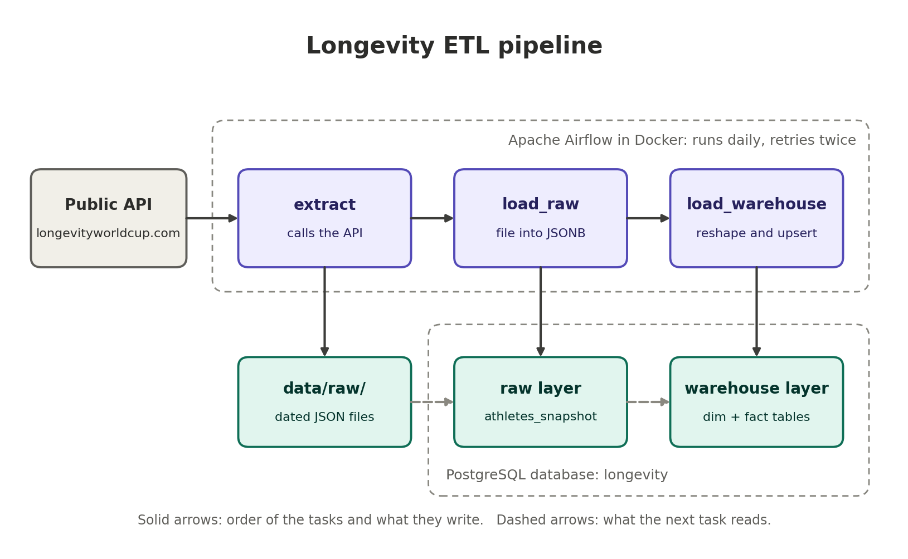
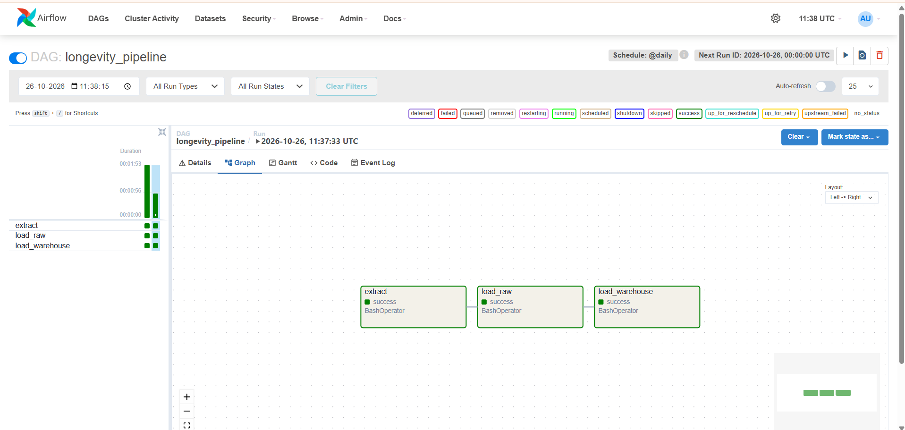

# Longevity ETL Pipeline

A daily data pipeline built in Python. It pulls the public Longevity World Cup leaderboard (a competition ranked by biological age), saves an untouched copy of everything it receives, and loads a cleaned version into a PostgreSQL warehouse. Apache Airflow, running in Docker, runs it every day and retries it when something fails.

The API only shows today's leaderboard. Because the pipeline stores a snapshot every day, it slowly builds a history of who moved up and down the rankings, which the source doesn't give you. I built it to learn the data engineering side of things: orchestration, warehouse tables, and loads that are safe to re-run.



## How it works

The pipeline is three small Python scripts, run in order by Airflow. Each one does a single job, so if something breaks you know exactly where.

**1. extract** calls the API and saves each response as a JSON file named with the time it was pulled. Nothing is cleaned or changed at this stage. It's the original receipt, so if my cleaning logic is ever wrong I can fix it and reprocess instead of asking the API again.

**2. load_raw** copies that file into Postgres as a single JSONB row in `raw.athletes_snapshot`. The filename is unique, so loading the same file twice does nothing.

**3. load_warehouse** reads the newest raw snapshot and fills three tables:

- `dim_athlete` has one row per athlete. Only the birth year is kept.
- `fact_biomarker_result` has one row per lab value, for one athlete on one test date. Each athlete's lab records arrive as nested JSON with up to about 20 markers, many of them missing, so this step reshapes them into tidy rows.
- `fact_athlete_daily` has one row per athlete per day, with placement, crowd age, crowd count, and submission count. This is the table that builds up history over time.

Every insert is an upsert (`ON CONFLICT ... DO UPDATE`), so running the pipeline twice updates existing rows instead of creating duplicates. A lab result never changes once recorded, but placement and crowd guesses change daily, which is why those live in a daily snapshot table.

**Airflow** ties it together. It runs the three scripts in order every day, and if a task fails it retries twice before marking it red and stopping the chain.



At the time of writing the warehouse holds 244 athletes and 3,966 lab values.

## Stack

- Python, requests, psycopg2
- PostgreSQL, with JSONB for the raw layer
- Apache Airflow 2.10 in Docker

## Run it

I built and tested this on Windows with Docker Desktop and a local PostgreSQL install. Postgres runs on your machine, and only Airflow runs in Docker.

Set up Python:

```bash
python -m venv venv
venv\Scripts\activate
pip install -r requirements.txt
```

Create an empty Postgres database called `longevity`, then build the tables:

```bash
psql -U postgres -d longevity -f sql/01_schema.sql
psql -U postgres -d longevity -f sql/02_warehouse.sql
```

Copy `.env.example` to `.env` and put in your Postgres password. Then try the steps by hand:

```bash
python src/extract.py
python src/load_raw.py
python src/load_warehouse.py
```

A successful warehouse load prints something like this:

```
using snapshot from 2026-10-25 with 244 athletes
athletes loaded: 244
lab values loaded: 3966
daily rows loaded: 244
done
```

Run it a second time. The athlete and lab-value counts in the database shouldn't change, because the loads are safe to repeat.

To run it with Airflow instead:

```bash
docker compose up
```

Wait a few minutes, then open `http://localhost:8080` and log in as `admin`. Get the generated password with:

```bash
docker compose exec airflow cat /opt/airflow/standalone_admin_password.txt
```

Switch on the `longevity_pipeline` DAG and press Trigger. Airflow only runs while Docker is running, so a closed laptop means a skipped day.

## Things I did on purpose

- **Keep the raw data.** The raw layer exists so the warehouse can always be rebuilt.
- **Privacy.** The API response includes contact emails and full birth dates for real people. The warehouse keeps neither. The raw JSON files on disk do contain them, so the `data/` folder is gitignored and never committed.
- **Zero isn't always zero.** A crowd age of 0 with no guesses means nobody guessed yet, so it's stored as NULL.

## Skills demonstrated

- **Python:** calling a REST API with `requests`, reading and writing JSON, talking to Postgres with `psycopg2`, error handling, and keeping settings in a `.env` file.
- **SQL and PostgreSQL:** designing schemas, primary and foreign keys, composite keys, JSONB columns, and upserts with `ON CONFLICT`.
- **Data modeling:** a star schema with dimension and fact tables, deciding what one row means in each table, and a daily snapshot fact table to track change over time.
- **ETL design:** separate raw and warehouse layers, loads that are safe to re-run, reshaping nested JSON into tidy rows, and cleaning values like "0 means no data".
- **Orchestration:** an Apache Airflow DAG with task dependencies, a daily schedule, and automatic retries.
- **Docker:** running Airflow with Docker Compose and connecting it to a Postgres database on the host machine.
- **Engineering habits:** Git and GitHub, keeping secrets and raw data out of version control, and leaving out personal data (emails and full birth dates) on purpose.

## Data source

Public API from [Longevity World Cup](https://longevityworldcup.com). It describes real people, so please use it respectfully. This project is for learning data engineering, not for republishing anyone's personal health information.
