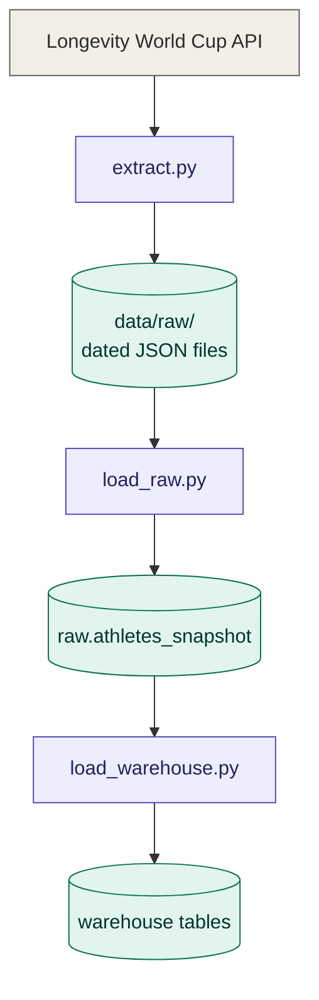
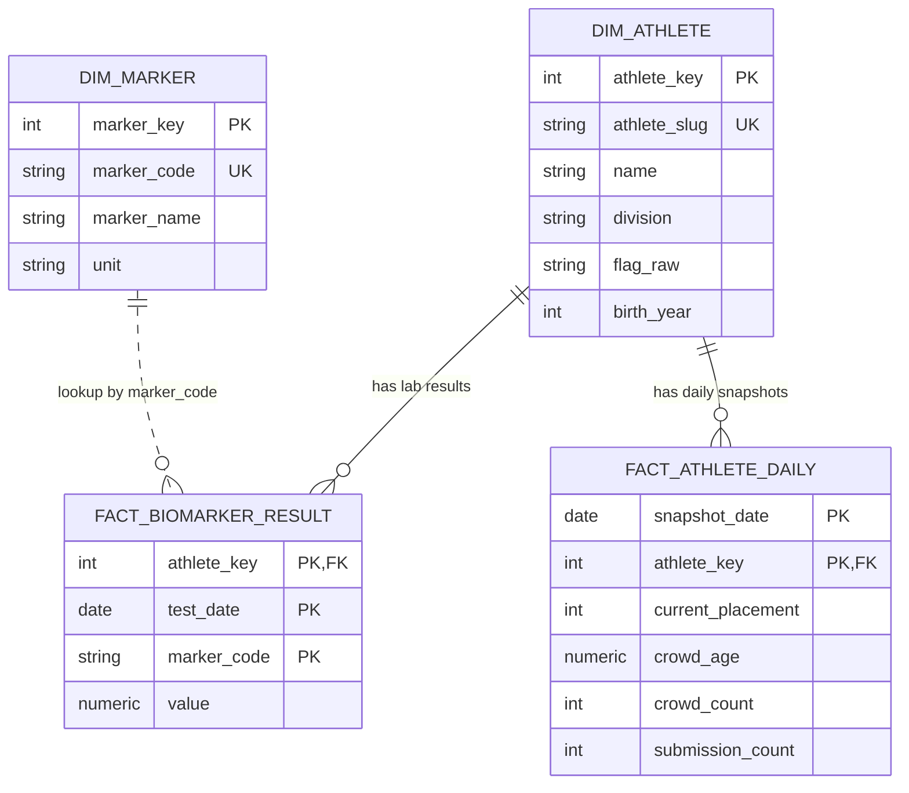

# longevity-etl-pipeline

A daily ETL pipeline that pulls the public Longevity World Cup leaderboard, keeps the raw JSON, and loads a cleaned version into a PostgreSQL warehouse. Built with Python and Airflow as a data engineering learning project.

## Stack

- Python 3, requests, psycopg2
- PostgreSQL (JSONB for the raw layer)
- Apache Airflow 2.10 in Docker

## How it works



Airflow runs the three scripts daily, in order, and retries a failed step twice.


| Step | Script | What it does |
|------|--------|--------------|
| 1 | `src/extract.py` | calls the API and saves each response as a dated JSON file |
| 2 | `src/load_raw.py` | copies the file into Postgres as JSONB (loading it twice does nothing) |
| 3 | `src/load_warehouse.py` | reshapes it into dimension and fact tables using upserts |

## Tables

| Table | One row per |
|-------|-------------|
| `raw.athletes_snapshot` | saved API pull (whole JSON) |
| `warehouse.dim_athlete` | athlete |
| `warehouse.fact_biomarker_result` | lab value (athlete + date + marker) |
| `warehouse.fact_athlete_daily` | athlete per day (rank, crowd age) |
| `warehouse.dim_marker` | lab marker (name and unit) |



At the time of writing the warehouse holds 244 athletes and 3,966 lab values.

## Run it

Set up Python:

```bash
python -m venv venv
venv\Scripts\activate
pip install -r requirements.txt
```

Create an empty Postgres database called `longevity`, then build the tables:

```bash
psql -U postgres -d longevity -f sql/01_schema.sql
psql -U postgres -d longevity -f sql/02_warehouse.sql
```

Copy `.env.example` to `.env` and set your Postgres password. Then run the steps by hand:

```bash
python src/extract.py
python src/load_raw.py
python src/load_warehouse.py
```

Run the last two again. Counts should not change, because the loads are idempotent.

Or run it with Airflow:

```bash
docker compose up
```

Open `http://localhost:8080` and log in as `admin`. Get the password with:

```bash
docker compose exec airflow cat /opt/airflow/standalone_admin_password.txt
```

Switch on the `longevity_pipeline` DAG and press Trigger. Airflow only runs while Docker is running.

## Example

Latest top 5 on the leaderboard:

```sql
SELECT a.name, d.current_placement, d.crowd_age
FROM warehouse.fact_athlete_daily d
JOIN warehouse.dim_athlete a USING (athlete_key)
WHERE d.snapshot_date = (SELECT max(snapshot_date) FROM warehouse.fact_athlete_daily)
ORDER BY d.current_placement
LIMIT 5;
```

## Notes

- The API response includes contact emails and full birth dates. The warehouse keeps neither, only the birth year.
- The raw JSON files do contain that data, so `data/` is gitignored and never committed.
- A crowd age of 0 with no guesses is stored as NULL, because it means nobody guessed yet.

## To do

- [ ] add data quality checks as an Airflow task
- [ ] clean country names ("USA" vs "United States")
- [ ] foreign key from `fact_biomarker_result` to `dim_marker`
- [ ] model badges and placements
- [ ] add a dashboard

## Data source

Public API from [Longevity World Cup](https://longevityworldcup.com). It describes real people, so please use it respectfully.
